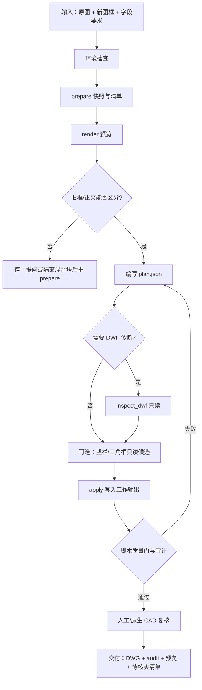

# 图框替换流程说明

本文档根据仓库根目录 [`SKILL.md`](../SKILL.md) 整理，面向在本仓库执行「DWG/DXF 图框提取与替换」的操作者。细节规则、禁令与质量门字段以 `SKILL.md` 及 [`references/`](../references/) 为准；本页只给出可执行的阶段顺序与产物约定。

## 目标与边界

| 要做 | 不做 / 不声称 |
| --- | --- |
| 从用户指定的原图识别旧图框，提取约定字段 | 不覆盖原图、新图框原件 |
| 导入用户另供的新图框资源并填充字段 | 不保证从文字轮廓恢复语义 |
| 仅删除证据充分的旧框实体并对齐新框 | 不按文件名或外观“猜”图；不矩形清层 |
| 另存新 DWG，脚本回读 + 人工/原生 CAD 复核 | 不把控制台打开成功当成打印验收通过 |

依赖见根目录 [`README.md`](../README.md)：Python ≥ 3.11、`ezdxf>=1.4`、ODA File Converter（DWG）；可选 `requirements-optional.txt`（DWF 诊断、预览）。

## 总流程



## 目录约定（建议）

在任意任务目录下使用相对路径（勿把本机绝对路径写进仓库文档）：

```text
任务根/
  work/frame-job/     # prepare 生成的快照、清单、哈希
  work/*.png          # 预览
  plan.json           # 本任务替换计划
  outputs/            # 最终 DWG 与 .audit.json
```

仓库根 `.gitignore` 已忽略 `work/`、`outputs/`、`*.dwg`、`*.dxf`，避免把工程原件推进 Git。

## 阶段 0：环境检查

1. 确认 `$PY` 为 Python ≥ 3.11，且已 `pip install -r requirements.txt`。
2. DWG 读写：设置 `ODA_FILE_CONVERTER`，或保证 `ODAFileConverter` 在 PATH / macOS 标准应用路径可找到（实现见 `scripts/cad_io.py`）。
3. 仅当需要 DWF 诊断或 PNG/SVG 预览时安装 `requirements-optional.txt`。
4. 列出缺项后仍可继续只依赖已有能力的步骤（例如仅有 DXF 时可跳过 ODA）。

## 阶段 1：准备清单（只读）

```sh
export PY=python3
export SKILL=.   # 或克隆后的本仓库根目录

"$PY" "$SKILL/scripts/titleblock.py" prepare "原图.dwg" "新框.dwg" --workdir "work/frame-job"
"$PY" "$SKILL/scripts/titleblock.py" render "work/frame-job/source.snapshot.dxf" --layout Model --output "work/原图.png"
```

`prepare` 产出只读 DXF 快照、输入哈希、分布局实体清单与嵌套文字路径。后续修改必须基于该固定快照，避免转换后句柄漂移。

操作者核对（不可省略）：

1. 文件内容与用户说明/参考图一致（布局、图名、图号、桩号等证据）。
2. 判定旧框类型：独立 INSERT、嵌套图框、散线散字、外参/底图，或与正文同一总块。
3. 新框是否另含正文或多个框。
4. 对齐控制点至少两个方向；禁止盲用 bbox 自动缩放。

混合总块：不要删除总 INSERT；先隔离实例或复制块定义，工作副本验证后再重新 `prepare`。当前 `apply` **不会**自动完成隔离。

## 阶段 2：编写替换计划

对照 [`references/plan.md`](../references/plan.md) 编写 `plan.json`。

要点：

- 每个字段写清名称、来源路径/原值、目标位置与证据；用户给定新值用带证据的 `literal`。
- `protected_titles`：禁止改写的完整标题字符串列表，默认 `[]`。
- 提取范围与删除范围分开核对；读到字段 ≠ 可删该区域全部实体。
- 禁止按通用子串做全局替换。
- 模型空间与图纸空间的坐标、单位、视口比例不得混用。

可选只读辅助（默认不产生候选，需显式匹配文本）：

```sh
"$PY" "$SKILL/scripts/native_vertical_company.py" "原图.dwg" --company-text "单位全称" --output "work/candidates.json"
"$PY" "$SKILL/scripts/triangle_frames.py" "原图.dwg" --marker-text "标记子串" --output "work/triangles.json"
```

`--company-text` / `--marker-text` 为**子串匹配**；`--marker-text` 可重复传入。有限竖栏单位修正见 [`references/outline-vertical.md`](../references/outline-vertical.md)，不得把有限修正说成整框替换完成。

DWF 分支（可选）：

```sh
"$PY" "$SKILL/scripts/inspect_dwf.py" "原件.dwf" --output "work/dwf-diag.json"
```

存在截断/未知 opcode 时不得声称完整读取。

## 阶段 3：应用与脚本验收

```sh
"$PY" "$SKILL/scripts/titleblock.py" apply "plan.json" --output "outputs/更新图框.dwg"
```

`apply` 在失败时不发布最终 DWG。常见拒绝条件包括：输入哈希变化、无效/重复句柄、错误原字段、输出已存在、删除视口/图像/底图/代理/外参/MINSERT、两字段争用同一目标等（详见 `SKILL.md`）。

若 plan 中配置了 `quality_gate`，发布前对导出 DWG 回读执行同一检查；配置项见 [`references/quality-gate.md`](../references/quality-gate.md)。导入后的新句柄须从暂存文档回读重建，不能沿用猜测原句柄。

`manual_review.number_lines`、`manual_review.extra_old_frame_lines` 等属于**定制流程**字段，`titleblock.py apply` **不读取**。

## 阶段 4：人工与原生 CAD 复核

脚本通过不等于交付通过。至少完成：

1. 同一布局替换前后整体预览 + 图框局部：旧框消失、新框方位正确、字段不溢出、正文不被挡。
2. 布局数量、视口位置与比例、其他未替换图框；打印/外参设置应保留。
3. 复杂对象、特殊字体、动态块、签名：优先本机原生 CAD 打开；方法见 [`references/native-review.md`](../references/native-review.md)。
4. 无法验证的项写入「待核实」清单，不得写成已验收。

## 交付物清单

| 产物 | 说明 |
| --- | --- |
| `outputs/*.dwg` | 新图，非原件覆盖 |
| `*.audit.json`（或脚本等价报告） | 输入哈希、删除句柄、新插入块标识 |
| 替换前后预览图 | 整体 + 图框局部 |
| 待核实清单 | 未做原生 CAD / 打印 / OCR 不确定项等 |

批量时：每个布局、每个图框、每个字段分别匹配；禁止把同一组字段按遍历顺序套到所有图纸。

## 仓库文档索引

| 文档 | 用途 |
| --- | --- |
| [README.md](../README.md) | 依赖、目录、最短命令 |
| [SKILL.md](../SKILL.md) | 完整操作规则与禁令（技能正文） |
| [docs/workflow.md](workflow.md) | 本流程（阶段顺序与产物） |
| [references/plan.md](../references/plan.md) | `plan.json` 字段 |
| [references/quality-gate.md](../references/quality-gate.md) | 质量门配置 |
| [references/native-review.md](../references/native-review.md) | 原生 CAD 复核 |
| [references/outline-vertical.md](../references/outline-vertical.md) | 轮廓竖栏有限修正 |
| [references/research.md](../references/research.md) | 上游调研（历史背景，非本包附带验收证据） |

## 变更说明

- 初版：由 `SKILL.md` 抽取阶段化流程，按 GitHub `docs/` 惯例落库，并与根 README 交叉链接。
